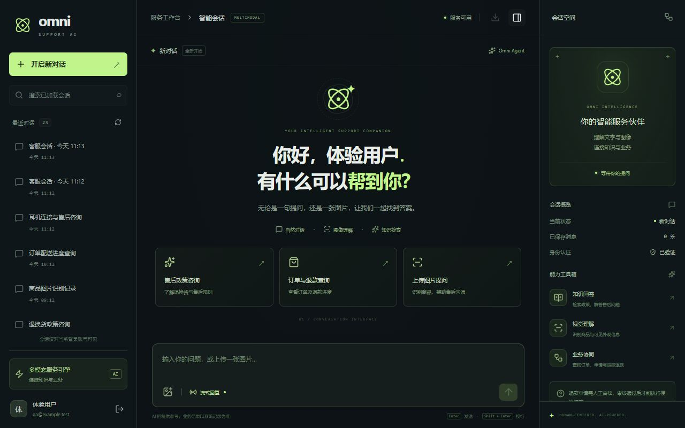
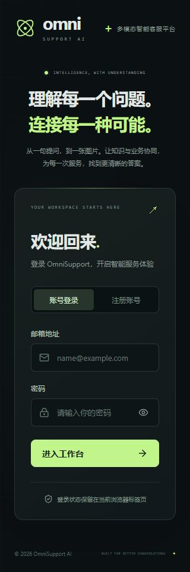
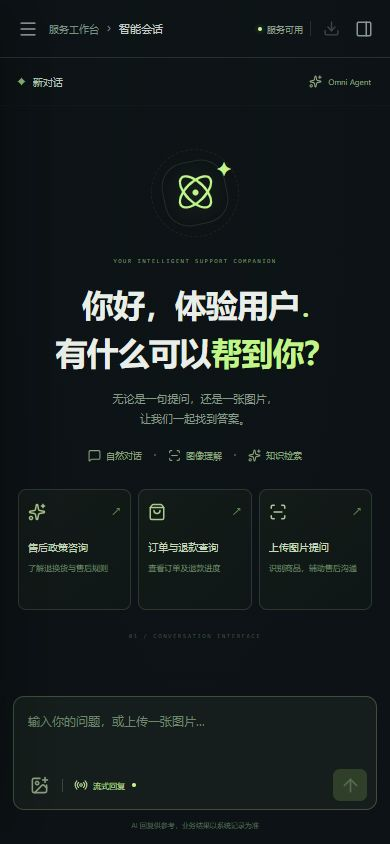
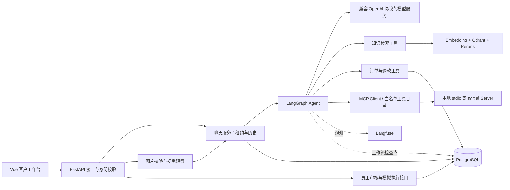

# OmniSupport AI

**面向电商售后的多模态智能客服与业务执行助手。**

以「咨询政策 → 查询订单 → 提交退款申请 → 人工审核 → 模拟退款 → 查询结果」为主线，将图像理解、RAG 知识检索、LangGraph Agent 和受权限约束的业务服务连接起来，并提供 Vue 客户工作台。

项目重点是 AI 应用后端与业务流程工程化：模型负责理解和选择工具，身份、订单归属、状态流转及数据库写入由服务端校验。当前为个人工程实践项目，退款执行是**数据库内的模拟流程，不涉及真实支付或资金转移**。

[界面预览](#界面预览) · [系统架构](#系统架构) · [工程实现](#工程实现) · [本地运行](#本地运行) · [验证与边界](#验证与边界)

## 界面预览



> 截图中的账号与会话为隔离模拟接口生成的演示数据；正式前端调用配置的真实后端。支持深色工作台、会话侧栏、Markdown 消息、图片附件和移动端抽屉。

<details>
<summary>登录页与移动端预览</summary>





</details>

## 已实现功能

| 能力           | 实现范围                                                                             |
| -------------- | ------------------------------------------------------------------------------------ |
| 文字与图像客服 | 普通聊天、SSE 流式回复、商品图片观察与连续追问                                       |
| 企业知识问答   | Markdown 分段、Embedding、Qdrant 稠密向量与 BM25 检索、RRF 融合、Rerank 重排         |
| Agent 工具协作 | LangGraph 条件路由、本地工具、MCP 工具发现与调用、模型调用次数限制                   |
| 订单与退款     | 查询本人订单、提交申请、查询审核状态与模拟执行结果；工作人员通过独立接口审核和执行   |
| 身份与权限     | 客户/员工独立账号、Argon2 密码哈希、JWT 身份类型校验、员工角色限制、客户数据归属检查 |
| 会话与并发     | PostgreSQL 会话历史、稳定消息排序、分页、数据库租约、续期与处理权校验                |
| 可观测性       | Request ID、接口耗时、模型/工具日志、Langfuse 观测、PostgreSQL Checkpointer          |
| 客户工作台     | 注册登录、会话搜索与切换、新建对话、普通/流式发送、图片预览、复制与导出已加载消息    |

## 系统架构



### 技术栈

| 层次           | 技术                                                   |
| -------------- | ------------------------------------------------------ |
| API 与数据校验 | FastAPI、Pydantic、Uvicorn                             |
| 数据持久化     | PostgreSQL、SQLAlchemy Async、Psycopg、Alembic         |
| Agent 与工具   | LangGraph、Function Calling、MCP                       |
| 检索与生成     | OpenAI Python SDK、Qdrant、Embedding、BM25/RRF、Rerank |
| 观测           | Langfuse、结构化日志中的 Request ID 与耗时             |
| 前端           | Vue 3、TypeScript、Vite、Lucide、Marked、DOMPurify     |
| 检查           | Pytest / unittest.mock、vue-tsc、Vite Build、Prettier  |

具体 Python 依赖锁定在 [requirements.txt](requirements.txt)，前端依赖锁定在 [package-lock.json](frontend/package-lock.json)。

## 工程实现

### 1. 用业务状态约束 Agent 的写操作

Agent 可提交退款申请，但不能使用客户身份审核申请或执行退款。员工接口单独验证身份与角色，金额取自数据库订单，不由模型自由生成。

```text
客户明确申请
  → 校验订单归属、订单状态和已有有效申请
  → pending：等待审核
  → 员工审核 approved / rejected
  → approved 后单独执行模拟退款
  → execution.succeeded，订单更新为 refunded
```

- 有效退款申请使用 PostgreSQL **部分唯一索引**限制同一订单重复申请。
- 审核与执行使用行锁处理竞争；模拟执行记录、订单状态和成功审计在同一事务提交。
- 重复执行已成功的申请返回同一执行记录，不再次创建退款记录。
- 审核审计表通过数据库触发器限制常规 `UPDATE` / `DELETE`，保留追加历史。
- 单一退款提交工具在本轮成功时，路由到固定回复节点，明确区分「已提交」「已审核」「已执行」。

入口代码：[Agent 路由](app/agent/graph.py)、[退款申请服务](app/services/refund_service.py)、[模拟执行服务](app/services/refund_execution_service.py)。

### 2. 会话租约与过期请求隔离

模型响应较慢时，同一会话的并发请求可能交错读取或写入。当前实现使用数据库原子更新获取处理权，为每次处理生成独立 token，并设置 **120 秒租约、40 秒周期续期**。

保存消息时再次检查处理权与有效期；用户消息和客服回复在同一事务写入。释放时只允许持有对应 token 的请求释放，避免旧请求释放新请求的锁。任务取消后仍尝试完成锁释放。消息读取使用内部 `message_seq` 排序，解决同一事务消息时间相同的问题。

这里的处理权 token 与登录 JWT 是两个不同概念。实现见 [conversation_service.py](app/services/conversation_service.py)、[chat_service.py](app/services/chat_service.py)、[message_service.py](app/services/message_service.py)。

### 3. 混合检索与工具扩展

知识检索按以下步骤执行：

```text
问题 → Embedding → 稠密向量 / BM25 两路召回
     → Qdrant RRF 融合 → Rerank 重排 → 知识片段与来源
```

默认召回 5 条、重排返回 3 条；保留来源与片段编号。示例知识库为 [售后政策文档](knowledge/after_sales_policy.md)。这是一条已实现的检索链路，当前没有用量化评测证明其优于其他检索配置。

MCP Server 提供演示商品信息；Client 动态发现工具并转换成模型工具定义。工具白名单、发现缓存、失败短期缓存和超时控制用于限制暴露范围及避免反复启动发现进程。业务写工具保留在本地服务端校验路径中。

入口代码：[RAG](app/services/rag_service.py)、[Qdrant 查询](app/services/qdrant_service.py)、[MCP 工具目录](app/mcp_client/catalog.py)、[MCP Server](app/mcp_server/server.py)。

### 4. 流式输出的完成语义

后端通过 SSE 返回 `token`、`error`、`done`。只有生成结束且聊天记录保存完成后才发送 `done`；HTTP 200 或连接关闭本身都不代表业务完成。

前端处理跨网络分片的 UTF-8 和事件边界，逐步追加回复；断流时标记结果未确认并保留草稿，不自动重发可能触发业务工具的消息。切换会话时取消旧的读取请求，并检查请求身份，避免迟到的历史结果覆盖新会话。

入口代码：[聊天接口](app/api/v1/chat.py)、[SSE 解析](frontend/src/api/chat.ts)、[前端聊天状态](frontend/src/composables/useChat.ts)。

### 5. 多模态输入与展示边界

图片接口检查 MIME、文件签名、大小、完整性及像素数量，当前限制为 **JPG / PNG / WEBP、5 MB、2000 万像素**。视觉模型先生成观察结果，再将问题与观察交给 Agent；观察文字按不可信参考内容处理，不能用于证明商品真伪、订单归属或售后责任。

历史中保存问题、观察文字和回复，**未持久化原图片**。前端 Markdown 在渲染前经 DOMPurify 白名单清理，避免直接执行模型或历史消息中的 HTML。

## 本地运行

### 环境与服务

- 当前开发环境：**Python 3.14、Node.js 22.20、npm 10.9**；其他版本未完整验证。
- PostgreSQL：需有应用数据库，以及迁移和 Checkpointer 初始化所需的建表权限。
- Qdrant：服务端需支持当前代码使用的多语言全文索引、BM25 评分、`TextQuery` 与 RRF；不要默认使用缺少这些接口的旧版本服务。
- 模型服务：兼容 OpenAI Chat Completions / Embeddings，并支持工具调用、视觉输入和流式输出。
- Rerank 服务：与 [rerank_service.py](app/services/rerank_service.py) 的请求/响应格式兼容。
- Langfuse：用于观测，连接参数通过环境变量提供；本仓库不包含该服务的部署。

当前 Embedding 与 Rerank 实现分别固定使用 `qwen3.7-text-embedding-flash`、`qwen3.7-text-rerank`，向量集合为 **1024 维**。复现时需确认账号、地域、接口和模型支持情况；更换模型时同步检查这些服务文件与集合维度。

以下命令以 Windows PowerShell 为例，在你选择的目录克隆：

```powershell
git clone https://github.com/111wjh/OmniSupport-AI.git
cd OmniSupport-AI
py -3.14 -m venv .venv
.\.venv\Scripts\python.exe -m pip install -r requirements.txt
Copy-Item .env.example .env
```

编辑 `.env`，填写真实的 `DATABASE_URL`、随机生成的 `JWT_SECRET_KEY`、模型与 Rerank 地址、模型名称、API Key、Qdrant 和 Langfuse 配置。仓库只提供占位示例，不能直接当成有效凭据。

如果需要新建演示数据库，在 PostgreSQL 管理连接中准备应用角色和数据库，例如：

```sql
CREATE ROLE omnisupport_app LOGIN PASSWORD 'replace-with-a-strong-password';
CREATE DATABASE omnisupport_ai OWNER omnisupport_app;
```

然后在仓库根目录执行：

```powershell
.\.venv\Scripts\python.exe -m alembic upgrade head
.\.venv\Scripts\python.exe -m app.services.qdrant_initializer
.\.venv\Scripts\python.exe ingest_knowledge.py
.\.venv\Scripts\python.exe -m uvicorn app.main:app --reload --host 127.0.0.1 --port 8000
```

Qdrant 初始化和知识导入需要对应服务及模型可用。FastAPI 启动时会执行 Checkpointer 的表初始化。MCP 商品 Server 由 Client 通过当前 Python 解释器按需以 stdio 启动，无需另开 HTTP 服务。

在另一个终端进入仓库根目录，再启动前端：

```powershell
cd frontend
npm ci
npm run dev
```

访问地址：

- 客户页面：`http://127.0.0.1:5173`
- Swagger 接口文档：`http://127.0.0.1:8000/docs`
- 健康检查：`http://127.0.0.1:8000/health`

前端可通过 `frontend/.env.local` 的 `VITE_API_BASE_URL` 更换后端地址，修改后重启 Vite。`VITE_` 变量会进入浏览器，不要放任何密钥。更换前端来源或端口时，同步调整后端 CORS。

Windows 下手写异步数据库脚本时，Psycopg 需要兼容的 Selector 事件循环，可参考 [create_staff.py](app/commands/create_staff.py) 的 `loop_factory`。不要在默认 Proactor 循环中直接运行异步数据库脚本。

## 演示路径

1. 在客户页面注册自己的账号并登录；发送普通问候，检查普通/流式回复与历史保存。
2. 询问「蓝牙无线耳机 Pro 的保修政策」，检查知识工具调用及回答依据。
3. 上传商品图片，询问外观与可见破损，再在同一会话继续文字追问。
4. 在演示数据库准备本人测试订单，查询订单并申请退款。
5. 使用独立工作人员身份在 Swagger / Apifox 审核申请，再执行模拟退款，客户随后查询结果。

### 准备可复现的演示订单

仓库没有订单创建页面。先在客户页面注册 `demo@example.com`，再向**演示数据库**执行以下 SQL；邮箱可替换为你自己注册的测试账号：

```sql
INSERT INTO orders (
    id, order_number, customer_id, customer_name,
    product_name, total_amount, status, purchased_at
)
SELECT
    gen_random_uuid(), 'DEMO-ORDER-001', id, display_name,
    '蓝牙无线耳机 Pro', 99.00, 'paid', now()
FROM customers
WHERE email = 'demo@example.com'
ON CONFLICT (order_number) DO NOTHING;
```

客户可以发送：「请为订单 DEMO-ORDER-001 提交退款申请，原因是商品不符合使用需求。」这会创建真实的演示数据库记录。

工作人员账号由本地受控命令创建：

```powershell
.\.venv\Scripts\python.exe -m app.commands.create_staff
```

选择 `refund_reviewer` 或 `admin`，设置自己的密码。客户 Token 与员工 Token 不能混用。当前客户工作台不提供员工审核页面。

### 主要接口

| 方法与路径                                                              | 用途               | 身份             |
| ----------------------------------------------------------------------- | ------------------ | ---------------- |
| `POST /api/v1/customers/register`、`/login`                             | 注册与登录         | 公开入口         |
| `GET /api/v1/customers/me`                                              | 当前客户资料       | 客户             |
| `POST /api/v1/chat`、`/chat/stream`                                     | 普通/流式对话      | 客户             |
| `POST /api/v1/images/upload`                                            | multipart 图片问答 | 客户             |
| `GET /api/v1/conversations`                                             | 本人会话分页       | 客户             |
| `GET /api/v1/conversations/{id}/messages`                               | 本人历史消息分页   | 客户             |
| `POST /api/v1/refunds`、`GET /api/v1/refunds`                           | 提交与查询本人申请 | 客户             |
| `GET /api/v1/refunds/{id}/execution`                                    | 本人模拟退款结果   | 客户             |
| `POST /api/v1/staff/login`                                              | 员工登录           | 公开入口         |
| `GET /api/v1/refunds/pending`                                           | 待审核申请         | 有审核权限的员工 |
| `POST /api/v1/refunds/{id}/review`、`POST /api/v1/refunds/{id}/execute` | 审核、模拟执行     | 有审核权限的员工 |

## 验证与边界

### 自动化检查

```powershell
# 根目录：当前 24 项后端测试
.\.venv\Scripts\python.exe -m pytest -q

# 前端目录
cd frontend
npm run typecheck
npm run build
npm run format:check
```

后端测试通过 Mock / 认证依赖替换隔离真实模型与数据库，覆盖会话创建/复用、参数校验、超时与连接错误、未登录拦截、处理权冲突、失效保存、续期和锁释放，以及 SSE 成功/错误事件。导入应用仍需配置合法的 `DATABASE_URL`，但测试不依赖真实数据库连接。

前端已通过类型检查、构建、格式检查，并使用隔离模拟接口在浏览器验证：登录/退出与恢复、列表加载与搜索、32 条历史消息连续加载、快速切换、普通与流式回复、断流提示、图片表单和手机布局。真实模型、RAG 和退款流程的人工联调与这些自动化检查是不同层次，不能据此声称达到生产可靠性或某个性能指标。

### 当前限制与后续方向

- 退款没有接入真实支付网关；未实现支付回调、外部幂等键、对账与补偿任务。
- 权限按客户账号和员工角色隔离，尚未实现企业级多组织租户体系。
- 成功提交的固定回复路由只覆盖特定提交路径；其他业务表述仍需补充长会话下的工具调用与事实一致性评估，不能仅凭提示词保证模型一定调用工具。
- Checkpointer 记录每轮工作流；当前每轮使用独立 workflow ID，对话连续性来自消息历史，不等同于已实现任意中断点的跨轮自动恢复。
- 知识库目前为示例售后文档，尚无检索质量基准、生产压测或完整覆盖率统计。
- 原图片未持久化，未实现对象存储、上传扫描和图片历史恢复。
- 员工审核通过接口完成；部署、CI/CD、监控告警和完整端到端业务回归仍待完善。

## 代码导航

```text
app/
├── api/v1/             客户、会话、图像、退款和员工接口
├── agent/              LangGraph 节点、路由、流式模型与状态
├── tools/              本地工具定义与可信客户上下文执行
├── services/           聊天、检索、图像及业务服务
├── mcp_client/         工具发现、白名单、Schema 转换与调用
├── mcp_server/         演示商品工具
├── models/、schemas/   ORM 模型与请求响应结构
├── core/               认证、配置、Request ID、Checkpointer、观测
└── commands/           工作人员账号创建命令
frontend/src/
├── api/                公共请求与业务接口
├── composables/        登录和聊天状态
├── components/         客户工作台组件
└── utils/              时间与历史文本处理
migrations/             数据库版本迁移
knowledge/              示例售后知识
tests/                  聊天接口与服务回归测试
```

进一步阅读：[前端说明](frontend/README.md)、[前端代码导读](frontend/docs/前端代码导读.md)。
