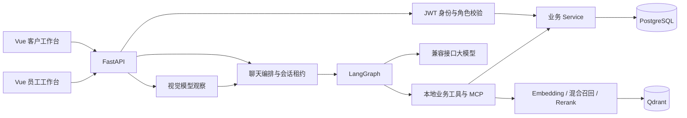

# OmniSupport AI：项目讲解与面试准备

## 1. 先用 90 秒讲清楚

这是一个面向电商售后的多模态客服演示项目。我把文字咨询、商品图片理解、企业知识检索，与订单、退款和人工工单串成了完整业务流程。

用户在 Vue 客户端登录后，可以咨询售后政策、上传商品图片，也能直接查看订单、申请退款和跟踪工单。后端用 FastAPI 提供接口，LangGraph 编排模型与工具；业务数据放 PostgreSQL，知识片段及向量放 Qdrant。模型负责理解需求和选择工具，真正的身份验证、数据归属、状态判断和数据库提交由服务端完成。

我重点处理了三个工程问题：用混合检索与重排给政策回答提供依据；用权限、事务、行锁和数据库唯一约束控制业务写入；用稳定请求编号处理超时重试，避免重复工单和重复聊天记录。

我做过 5 题、4 种检索方案的 Ragas 初步对照，也做过工单抢单、并发回复、关闭竞争和幂等故障恢复验证。项目的退款是数据库内模拟，没有接支付网关。它定位为可以复现和讲解的个人工程项目，尚未宣称达到生产性能指标。

## 2. 用户看见的业务闭环

1. 客户注册/登录，后端校验密码并签发客户 JWT。
2. 客户问政策，Agent 调用知识检索工具，获取企业资料后回答。
3. 客户上传图片，视觉模型生成观察，再让客服 Agent 结合问题和历史处理。
4. 客户在订单页查看本人订单，提交退款原因。
5. 有退款审核权限的员工登录员工工作台，审核通过或拒绝。
6. 审核通过后，员工单独执行模拟退款，返回执行记录。
7. 客户在退款页核对结果，在订单页确认状态变化。
8. 需要人工协助时，客户可直接建工单，或通过 Agent 建单。
9. 客服领取工单，客户与客服通过工单记录沟通。
10. 客服关闭工单，双方仍可读历史，但不能继续追加回复。

不要把“创建人工工单”讲成“人工实时加入 AI 聊天”。当前是异步工单沟通。

## 3. 架构与每层职责

- Vue：收集输入、展示状态、调用接口、处理 SSE 和失败提示，不判定客户是否有权退款。
- FastAPI 路由：参数校验、认证依赖、业务异常到 HTTP 状态码的转换。
- Service：订单归属、状态机、事务和数据库读写。
- Agent：接收问题、选择工具、解释结果。不能直接执行任意 SQL。
- PostgreSQL：账号、订单、会话、消息、退款、工单、审计，以及聊天操作幂等记录。
- Qdrant：知识片段和向量；不替代业务数据库。
- Langfuse：模型/工具调用追踪。普通日志也记录 request_id 与耗时。
- Redis：目前没有接入。本轮收尾没有新增 Redis、任务队列或部署系统。

## 4. 从一次普通聊天追代码

入口：`frontend/src/composables/useChat.ts` → `frontend/src/api/chat.ts`。

后端：`app/api/v1/chat.py` → `app/services/chat_service.py` → `app/agent/service.py` → `app/agent/graph.py`。

一次请求先确定客户及所属会话。有 client_request_id 时先创建或复用 chat_operations，已完成请求直接回放。处理中的请求需要获得会话租约，读取历史后再执行 Agent。

Graph 中 model 节点向模型发送消息和工具定义。模型若返回工具调用，tools 节点执行经过校验的工具。查询工具通常把结果交回模型继续回答；单次退款提交或单次工单创建有代码生成的固定业务回执，减少模型误报操作结果。

最终保存之前，会再次检查当前请求是否仍拥有会话处理权。用户与助手两条消息在同一事务提交；有发送记录时，其最终回复和完成时间也同时提交。最后释放处理权。

## 5. 为什么需要 LangGraph

它把“模型决定 → 工具执行 → 继续模型或结束”的循环显式表达成节点和条件边，便于维护执行次数限制、固定回执分支和流式事件。

这里不是为了把每一个 CRUD 接口都包装成 Agent。直接点击订单/工单页面时走普通业务接口，聊天场景才经过 Agent。

每轮 workflow_thread_id 独立。Checkpointer 保存工作流状态；持续对话依赖 PostgreSQL 消息历史。不能把当前设计说成“任何中断都能从任意节点自动恢复”。

## 6. RAG 到底做了什么

离线入库：Markdown → 清洗和切分 → Embedding → Qdrant，保留 source、chunk_index 等来源信息。评测语料导入支持独立集合与快照校验；日常运行与评测集合需要区分。

在线检索：问题 → Embedding → 稠密向量召回，同时执行 BM25 → RRF 融合 → 候选片段 → Rerank → 最终资料。

`app/services/rag_service.py` 的默认候选参数 recall_k=5，最终 top_n=3。实际融合细节见 qdrant_service；不要把这些参数误说成“整个库只检索 5 条数据”。

- BM25：词项匹配，对型号和特定术语有帮助。
- Dense：语义接近，能处理不同措辞。
- RRF：按排名融合不同召回结果，减少不同分数标度的影响。
- Rerank：让专用模型比较问题与候选文本，再排序。

聊天中的 search_knowledge 返回片段，由 Agent 组织答案；评测和独立知识问答可复用 generate_answer_from_knowledge。检索和回答生成应分开理解。

RAG 提供可参考的内容，不保证没有幻觉。仍需处理资料不足、型号不明、检索不相关及提示注入。

## 7. 评测怎样向面试官解释

我先固定题目、知识语料、召回结果和生成回答，再用相同指标比较 BM25、Dense、Hybrid、Hybrid+Rerank。结果文件包含输入、回答、评分与汇总，便于复核。

本次试跑：5 道题 × 4 种方案 = 20 组回答；每组 4 项指标，共 80 项评分。

| 方案 | Faithfulness | Answer Relevancy | Context Precision | Context Recall |
| --- | ---: | ---: | ---: | ---: |
| BM25 | 0.7434 | 0.8583 | 0.9167 | 1.0000 |
| Dense | 0.8918 | 0.8315 | 1.0000 | 1.0000 |
| Hybrid | 0.8183 | 0.8888 | 1.0000 | 1.0000 |
| Hybrid + Rerank | 0.8347 | 0.8682 | 1.0000 | 1.0000 |

- Faithfulness：回答中的陈述是否被检索上下文支持，不是一般意义上的事实准确率。
- Answer Relevancy：回答与问题的贴合程度，不直接保证正确。
- Context Recall：参考答案所需信息能否被召回上下文覆盖，不等同于传统检索中“所有相关文档”的召回率。
- Context Precision：相关上下文的排序质量；Ragas 的这个指标不能简单解释成“无关片段百分比”。

所有方案 Recall 都是 1，说明这 5 道题没有拉开该指标差异，不是系统已经实现 100% 生产召回。
Dense 在本轮忠实度上最高，也不足以证明它总体最好。样本小、单轮生成、同一模型生成与评审，均限制结论。评分还会受断言拆分及用户自述是否被纳入证据影响，需要人工看具体陈述。

依据：`reports/rag_comparison/pilot_v1/summary.md`。面试时说“初步对照实验”，不要说“全量工业级评测”。

## 8. 多模态怎样做，边界在哪里

图片接口校验 MIME、文件签名、大小、解码完整性和像素数。当前支持 JPG/PNG/WEBP，限制 5 MB 和 2000 万像素。

视觉模型先描述可见内容，再将观察和客户问题交给聊天服务。观察按不可信参考处理，不能当系统指令，也不能证明订单归属、真伪、内部故障或责任。

当前没有持久化原始图片到对象存储。前端当前上传的缩略图使用临时对象 URL，刷新后不能据此恢复图片；历史仍保留标记后的观察文字。这是明确的实现边界。

## 9. 退款状态为什么分两套

退款申请：pending → approved / rejected。
退款执行：pending / succeeded / failed。

申请通过只表示允许后续处理，不代表已经执行退款。
模拟执行需要员工权限，再次检查申请和订单状态。执行时锁定相关行，创建执行记录、修改订单状态并写审计，保证数据库内原子性。重复执行成功记录可返回原记录。

订单金额用 Decimal，避免浮点金额误差。
有效退款申请有部分唯一索引，限制同订单重复有效申请。
审计有数据库触发器约束追加历史，但不能宣称数据库超级用户也无法篡改。

真实支付接入还需要支付网关请求幂等、回调验签、对账、外部超时状态查询和补偿。当前没有这些能力。

## 10. 工单并发怎么保证

工单状态：open → in_progress → closed。

领取、回复、关闭锁定同一个工单行，锁内重新核对状态及归属。这里的关键不是 Python if 判断，而是让竞争请求在同一个数据库资源上串行决定。

抢单：两人争同一张 open 工单，一人成功，另一人冲突。
回复：工单内 message_seq 递增，数据库唯一约束保护序号，消息和活动时间一起提交。
关闭与回复：先获得锁并完成校验的一方决定当前操作；关闭成功后的新回复应拒绝。

已有人工并发验证：抢单 200/409；10 条并发回复都成功，序号 1–10；一次关闭竞争中回复先成功，最终 11 条消息，关闭后双方都收到 409。
不能据此声称所有调度顺序或高吞吐量都被证明；原验证未观察到关闭先完成分支的实际竞争过程。

## 11. 幂等与行锁有什么不同

行锁协调“同时执行”的请求；幂等识别“同一次操作的重复请求”，包括隔很久后的网络重试。

工单 API 使用客户 ID + Idempotency-Key 唯一约束。相同键和指纹返回同一工单，不同内容返回 409。
指纹是验证后的内容规范化 JSON 的 SHA-256。数据库冲突后先 rollback，再查询获胜记录；不能只靠“先查一下有没有”。

聊天还要保存一次发送到原会话的映射，否则首次请求超时，重试时会先创建新的会话。
chat_operations 保存客户、client_request_id、原输入指纹、会话、图片观察、最终回复与完成时间。
首次会话和发送记录在同一事务创建，竞争落败方连同新会话回滚。
后端派生工单工具键，模型不能指定身份和键。

已完成：直接回放。
尚未完成但工单已提交：读实际工单恢复回执，不重新调用模型建单。
尚无工单：正常继续 Agent。
历史消息和操作完成结果一起提交。

工单回复尚无请求级幂等；多工具写入不是一个跨工具原子事务。旧请求不传 client_request_id 时不保证跨 HTTP 请求去重。

## 12. 会话租约为什么还有 Token

模型调用可能很慢，不能一直占着数据库事务等模型。
因此使用带到期时间的会话处理权，周期续期，结束释放。
每次持有者获得 UUID Token，续期、释放和最终保存都核对它。旧请求即使后来恢复执行，也不能释放新请求的处理权或把过期结果写入历史。

Token 是持有者标识，并非自动等同于全局递增的分布式序列号。当前防过期写入的落点是 PostgreSQL 的锁内持有者与到期时间检查。
业务工具的独立写入仍依赖各自的权限、状态、事务与幂等；会话租约不能替代全部业务并发保护。

## 13. SSE 为什么适合这个项目

浏览器用 fetch 发送 POST，Authorization 携带 JWT，再读取响应流。这样请求可以带 JSON 和自定义认证头。
token 事件传文字，done 返回会话编号；后端出错使用 error 事件。

收到文字不代表保存成功。前端只有拿到 done 才标记完成，断流显示未确认，不自动重发。
单次固定业务回执可能以一个完整 token 事件输出，不是每个字逐字生成。
SSE 是服务器单向推送；当前不需要双向实时协作，因此未为这一功能引入 WebSocket。

## 14. 前端如何保持维护性

- App.vue 管理客户/员工入口和一级页面导航。
- api/http.ts 统一认证头、错误与响应解析；api/business.ts 定义业务数据和运行时检查。
- useAuth、useStaffAuth 管理相互独立的登录凭证和身份恢复。
- usePage 管理分页、取消旧读取和失败状态；useAction 防止同组件重复写入，并展示错误。
- OrdersView、RefundsView、TicketsView 各自负责一个业务领域。
- BusinessWorkspace 根据员工角色显示相应入口。真正权限仍由后端验证。
- useChat 管理历史与发送状态；chatIdentity 使用摘要及稳定 UUID 处理相同发送的重试。
- PageControls 统一分页；样式沿用深色、绿色/青色强调和响应式布局。
- 后端以客户身份限定查询，前端隐藏按钮只是用户体验，不构成安全边界。
- 密码不落存储；客户和员工 Token 使用不同 sessionStorage 键。真实部署还应统一评估 XSS、令牌生命周期和安全策略。

## 15. 数据库重点表

Customer / Staff：两类身份，员工带角色。
Order：所属客户、订单号、商品、Decimal 金额和订单状态。
Conversation / Message：会话归属、租约字段、按序保存的聊天。
RefundRequest / RefundExecution：申请和模拟执行分离。
RefundAuditEvent / RefundExecutionAuditEvent：追加审计。
Ticket / TicketMessage：人工工单、领取者、沟通序号和关闭时间。
ChatOperation：一次发送的持久化映射及回放结果。
LangGraph checkpoint 表由 Checkpointer 管理，Alembic 自动比较时排除，防止误删。

## 16. 测试证据与不能夸大的内容

40 项后端用例包括 24 项原有聊天回归和 16 项 PostgreSQL 幂等集成测试。默认数据库用例跳过，需显式设置 OMNISUPPORT_DB_TESTS=1。
数据库用例仅访问专用测试库的随机 schema，替换模型节点和外部追踪，真实执行 Graph、HTTP/SSE、工具与事务。

前端模拟接口测试与真实后端联调必须区分。模拟测试能验证路径、参数、页面状态和渲染，不能证明真实模型的回答质量，也不能替代真实支付或生产压测。

## 17. 五分钟演示顺序

准备：启动 PostgreSQL、Qdrant、后端和前端；配置模型服务；导入模拟知识；通过 create_staff 创建员工，通过 create_demo_order 创建客户演示订单。

1. 客户登录，展示已有历史、文字问题和图片咨询。
2. 展示订单页，选择本人订单，填写原因提交退款。
3. 切换员工入口，有权限员工审核通过，再单独模拟执行。
4. 回客户入口刷新退款结果与订单状态。
5. 客户建立人工工单；客服在待领取队列领取。
6. 客户补充，客服回复，再关闭；客户刷新后看到关闭状态和历史。
7. 展示幂等与评测报告，解释网络重试与实验结论边界。

涉及写入的演示用模拟订单和测试内容；不在面试中展示 .env、API Key、密码或真实个人资料。
员工执行入口要求输入已审核申请 UUID，这是因为现有后端仅提供待审队列，没有已审核队列接口；不假装前端存在后端未提供的列表能力。

## 18. 面试常见追问

**为什么不用纯提示词？**
政策、订单和退款是不同来源的信息。提示词不能获得实时数据库事实，也不能替代权限校验。RAG 提供企业资料，业务工具提供当前状态。

**为什么不用 Dify 完成全部？**
我用自己的后端实现可审查的业务规则、事务和并发控制。Dify 是额外的学习实践，没有嵌进这个代码库的主运行链路。需要快速编排时可以评估平台，但不能把后端规则只交给提示词。

**为什么没有 Redis？**
当前尚未测出需要 Redis 解决的生产瓶颈。已有 MCP 进程内缓存。后续可以先做接口限流或查询 Embedding 缓存，再通过命中率、调用数和 P95 验证收益。数据库唯一约束和事务仍保留。

**最难的地方是什么？**
推荐用真实案例回答：工单已提交但聊天事务失败。仅靠前端禁用按钮或数据库行锁都不能覆盖跨请求重试，需要稳定操作号、持久化会话映射和真实业务回执恢复。

**有哪些不足？**
没有真实支付、工单实时推送、生产部署和 CI/CD；RAG 仅小样本初评；多工具混合调用的结果呈现仍需完善；原图未持久化；没有生产吞吐量和 SLA 数据。

**用了 AI 辅助怎么讲？**
如实说明 AI 辅助了代码实现和排查，明确自己参与的需求、学习、联调和验证。能讲出关键代码、失败场景和取舍，比声称每行都独立手写更可信。不要编造生产用户、公司经历、性能提升或上线规模。

## 19. 建议阅读路径

先看 README，接着按“接口 → Service → Model/事务”追一次订单/工单。
再读 chat_service、agent/graph、agent/nodes、tools/executor。
然后读 rag_service、qdrant_service、rerank_service 和评测报告。
最后结合 ticket_idempotency.md、ticket_concurrency.md、测试用例解释异常路径。
前端只需要先掌握 App 的入口、api 请求层、composable 状态层和页面组件分工，再逐步看 Vue 语法。

## 20. 项目收尾定位

本轮完成业务页面后，进入展示与学习阶段，暂停新增功能。收尾不是宣布生产就绪。
面试重点放在：业务闭环、模型与业务边界、数据一致性、可复现验证，以及知道哪些结论尚无证据。
